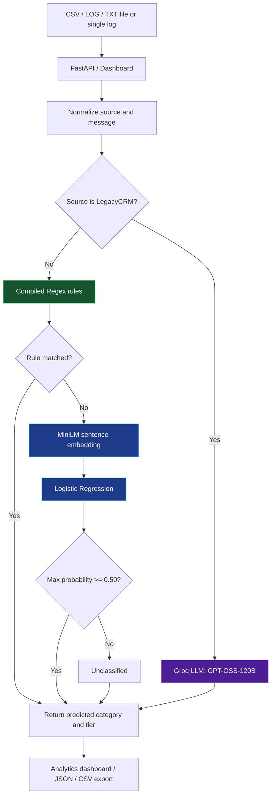
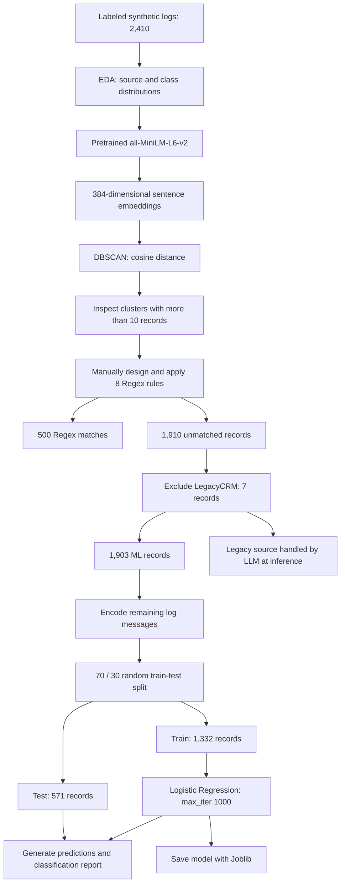

<div align="center">

# LogGuard AI

### Hybrid AI-Powered Log Classification & Analytics System

**From unstructured software logs to actionable operational intelligence.**

[](https://www.python.org/)
[](https://scikit-learn.org/)
[](https://www.sbert.net/)
[](https://pytorch.org/)
[](https://fastapi.tiangolo.com/)
[](https://groq.com/)
[](https://streamlit.io/)
[](https://plotly.com/python/)
[](https://developer.mozilla.org/en-US/docs/Web/JavaScript)

[Overview](#-overview) · [Architecture](#-system-architecture) · [Training](#-training-workflow) · [Results](#-model-evaluation) · [Setup](#-getting-started) · [API](#-api-reference)

</div>

---

## 📌 Overview

LogGuard AI is an end-to-end hybrid AI application that automatically categorizes logs generated by software applications, servers and enterprise IT systems. It combines regular expressions, pretrained sentence embeddings, supervised machine learning and prompt-based Generative AI to turn raw log messages into structured information for operational analysis.

Traditional log-level monitoring relies on labels such as `INFO`, `WARNING` and `ERROR`. These labels may be inconsistent across applications or fail to communicate the actual event: an application crash, for example, might be recorded at the `INFO` level. LogGuard AI instead classifies the content of a message into meaningful event categories, including security alerts, resource usage, HTTP status, system notifications and workflow errors.

Rather than sending every log to an external LLM, the system uses inexpensive local rules and a trained classifier for supported cases, reserving LLM inference for a legacy source with scarce labeled examples. The objective is to balance classification quality, inference overhead and API usage.

### Key features

- **Three-engine hybrid classification:** compiled Regex rules, MiniLM sentence embeddings with Logistic Regression, and GPT-OSS-120B via GroqCloud.
- **Unsupervised pattern discovery:** DBSCAN clustering with cosine distance to inspect recurring log templates and design rules.
- **Confidence-aware ML inference:** predictions below a maximum class probability of `0.50` are returned as `Unclassified`.
- **Batch and single-log inference:** CSV, LOG and TXT uploads through the web API, plus individual message classification.
- **REST API and dashboards:** FastAPI with Swagger documentation, a responsive HTML/CSS/JavaScript dashboard and an optional Streamlit + Plotly interface.
- **Operational analytics:** category distributions, source breakdowns, routing share, filtering and CSV export; single-log API latency measurement.

## 🏗️ System Architecture



The router in `training/classify.py` uses **source-based routing**: `LegacyCRM` is sent directly to the LLM; all other sources are checked against Regex rules before ML inference. Low-confidence ML predictions are rejected as `Unclassified` rather than automatically forwarded to the LLM.

| Engine | Implementation | Categories handled | Inference characteristics |
| --- | --- | --- | --- |
| **Tier 1 — Regex** | `processor_regex.py` | User Action, System Notification | Local pattern matching; no LLM API call |
| **Tier 2 — ML** | `processor_BERT.py` | HTTP Status, Security Alert, Error, Critical Error, Resource Usage; or Unclassified | Pretrained `all-MiniLM-L6-v2` embeddings + Logistic Regression, running locally |
| **Tier 3 — LLM** | `processor_LLM.py` | Workflow Error, Deprecation Warning; or Unclassified | Prompt-based classification via GroqCloud; subject to network latency, quotas and pricing |

The tier labels identify the engine, not incident severity. Local processing share measures the proportion of messages handled without the external LLM; it is not a measured monetary saving.

## 📊 Dataset

Training uses `training/dataset/synthetic_logs.csv`, a **synthetic labeled dataset of 2,410 records** from six application sources. The training notebook shows the following source distribution.

| Application source | Records |
| --- | ---: |
| ThirdPartyAPI | 496 |
| ModernHR | 492 |
| BillingSystem | 479 |
| AnalyticsEngine | 471 |
| ModernCRM | 465 |
| LegacyCRM | 7 |
| **Total** | **2,410** |

| Field | Description |
| --- | --- |
| `timestamp` | Time of the recorded event |
| `source` | Application or service generating the log |
| `log_message` | Raw text describing the event |
| `target_label` | Ground-truth category in the training dataset |
| `complexity` | Dataset metadata indicating the intended processing approach |

<details>
<summary><strong>View target class distribution</strong></summary>

| Category | Records |
| --- | ---: |
| HTTP Status | 1,017 |
| Security Alert | 371 |
| System Notification | 356 |
| Error | 177 |
| Resource Usage | 177 |
| Critical Error | 161 |
| User Action | 144 |
| Workflow Error | 4 |
| Deprecation Warning | 3 |
| **Total** | **2,410** |

</details>

The seven `LegacyCRM` records contain the two scarce classes. Rather than fitting a supervised classifier with only four workflow errors and three deprecation warnings, the project uses prompt-based LLM inference for this source.

## 🧠 Training Workflow

The complete experimentation and model-training process is documented in [`training/training.ipynb`](training/training.ipynb).



### 1. Exploratory data analysis

Inspect source frequencies, category frequencies and the available labeled examples. The scarcity of legacy examples motivates the separate LLM route.

### 2. Semantic embeddings and pattern discovery

Use a pretrained Sentence Transformer to represent each message numerically. DBSCAN groups nearby embeddings using cosine distance, allowing recurring templates to be examined without using the target labels in clustering.

```python
model = SentenceTransformer("all-MiniLM-L6-v2")
embeddings = model.encode(df["log_message"].tolist())

dbscan = DBSCAN(eps=0.2, min_samples=1, metric="cosine")
df["cluster"] = dbscan.fit_predict(embeddings)
```

Inspect clusters containing more than ten records, then manually design eight Regex rules covering repeated patterns such as login/logout, backup completion and account creation. DBSCAN is used during experimentation, not during runtime classification. With `min_samples=1`, the configuration favors discovering groups including singletons rather than identifying noise.

### 3. Hybrid dataset partitioning

| Processing path | Records in the notebook | Share of dataset |
| --- | ---: | ---: |
| Regex matches | 500 | 20.75% |
| ML candidate records | 1,903 | 78.96% |
| Legacy LLM route | 7 | 0.29% |
| **Total** | **2,410** | **100%** |

These are dataset partition counts, not a production benchmark or measured inference routing accuracy.

### 4. Supervised model training

After excluding Regex matches and `LegacyCRM`, encode the remaining messages and fit a multiclass Logistic Regression classifier. The notebook uses a random 70/30 train-test split with `random_state=42` and `max_iter=1000`. The pretrained embedding model is not fine-tuned.

```python
X_train, X_test, y_train, y_test = train_test_split(
    filtered_embeddings, df_non_legacy["target_label"],
    test_size=0.3, random_state=42
)
clf = LogisticRegression(max_iter=1000)
clf.fit(X_train, y_train)
joblib.dump(clf, "../models/log_classifier.joblib")
```

## 📈 Model Evaluation

The notebook's saved classification report for the **MiniLM + Logistic Regression component** reports the following results on 571 test samples (rounded as printed in the notebook):

| Accuracy | Macro F1-score | Weighted F1-score | Test records |
| :---: | :---: | :---: | :---: |
| **99%** | **0.98** | **0.99** | **571** |

| Category | Precision | Recall | F1-score | Support |
| --- | ---: | ---: | ---: | ---: |
| Critical Error | 0.91 | 1.00 | 0.95 | 48 |
| Error | 0.98 | 0.89 | 0.93 | 47 |
| HTTP Status | 1.00 | 1.00 | 1.00 | 304 |
| Resource Usage | 1.00 | 1.00 | 1.00 | 49 |
| Security Alert | 1.00 | 0.99 | 1.00 | 123 |
| **Macro average** | **0.98** | **0.98** | **0.98** | **571** |
| **Weighted average** | **0.99** | **0.99** | **0.99** | **571** |

> **Evaluation scope:** These results are from the notebook's standard ML predictions, before the runtime confidence-rejection rule. They do not measure the entire three-tier system, Regex accuracy, LLM accuracy or production performance. The data is synthetic and contains recurring templates; the random split and pattern discovery before splitting may yield optimistic results. A template-disjoint or external real-log evaluation is needed to assess generalization.

## 🖥️ Dashboard & Analytics

The primary dashboard is served by FastAPI. It provides a unified interface for classifying uploaded files or individual logs and exploring predicted events.

<!-- Optional: save a screenshot as docs/dashboard.png, commit it, then uncomment the line below.

-->

| Dashboard component | Purpose |
| --- | --- |
| KPI cards | Logs analyzed, predicted security alerts, error-related events and locally processed share |
| Live classifier | Test a single log and inspect the category and processing engine |
| File upload | Process CSV, LOG and TXT files |
| Category and routing charts | Explore predicted labels and the share handled by Regex, ML and LLM |
| Source breakdown | Compare events across application sources |
| Event timeline (web UI) | Inspect temporal patterns when timestamps are available |
| Classified log explorer | Search, filter and export classified records |

An optional Streamlit interface provides batch upload, filtering, category and routing charts, source breakdown and CSV export. It invokes the Python classifier directly.

## 🛠️ Technology Stack

| Layer | Technologies |
| --- | --- |
| Programming & data processing | Python, Pandas, NumPy |
| Rule-based NLP | Python `re` |
| Semantic representation | Sentence Transformers, MiniLM (`all-MiniLM-L6-v2`), PyTorch |
| Unsupervised learning | DBSCAN (scikit-learn) |
| Supervised learning | Logistic Regression (scikit-learn) |
| Generative AI | GPT-OSS-120B, GroqCloud API, prompt engineering |
| Model persistence | Joblib |
| Backend | FastAPI, Uvicorn, Pydantic |
| Primary frontend | HTML, CSS, JavaScript |
| Optional analytics UI | Streamlit, Plotly |
| Experimentation & development | Jupyter Notebook, Git, GitHub |

## 📁 Project Structure

```text
logguard-ai-hybrid-log-classifier/
├── dashboard/
│   ├── index.html                 # Primary web dashboard
│   └── app.py                     # Optional Streamlit dashboard
├── models/
│   └── log_classifier.joblib      # Trained Logistic Regression artifact
├── training/
│   ├── dataset/
│   │   └── synthetic_logs.csv     # Labeled synthetic training data
│   ├── resources/
│   │   ├── test.csv               # Sample input
│   │   └── output.csv             # Generated output (gitignored)
│   ├── .env                       # Local secret file (gitignored)
│   ├── classify.py                # Hybrid routing and CSV processing
│   ├── main.py                    # FastAPI application
│   ├── processor_regex.py         # Compiled rules
│   ├── processor_BERT.py          # MiniLM + Logistic Regression inference
│   ├── processor_LLM.py           # Groq prompt-based classification
│   └── training.ipynb             # EDA, clustering, training and evaluation
├── .gitignore
├── requirements.txt
└── README.md
```

## 🚀 Getting Started

### Prerequisites

- Python 3.11 recommended, Git and an internet connection for the initial embedding-model download.
- A GroqCloud API key for LLM inference. The current LLM module initializes its client on import, so configure the key before launching the application.

### 1. Clone the repository and create a virtual environment

Windows PowerShell:

```powershell
git clone https://github.com/Nazik2020/logguard-ai-hybrid-log-classifier.git
cd logguard-ai-hybrid-log-classifier
python -m venv .venv
.\.venv\Scripts\Activate.ps1
python -m pip install --upgrade pip
python -m pip install -r requirements.txt
```

For a CPU-only PyTorch installation, install the matching CPU wheel before installing the remaining dependencies:

```powershell
python -m pip install torch --index-url https://download.pytorch.org/whl/cpu
```

### 2. Configure the environment

Create `training/.env` locally and insert your key from the [GroqCloud console](https://console.groq.com/keys):

```dotenv
GROQ_API_KEY=your_groq_api_key_here
```

The model identifier in the LLM processor is `openai/gpt-oss-120b`. It is accessed via GroqCloud using a Groq API key, not the OpenAI API. Availability, free-tier limits and costs depend on the provider.

> Never commit API keys, private logs or `.env` files. Use synthetic or sanitized logs for demonstrations.

### 3. Launch the FastAPI application

From the repository root:

```powershell
python -m uvicorn training.main:app --reload
```

| Interface | Local URL |
| --- | --- |
| LogGuard AI dashboard | [http://127.0.0.1:8000/](http://127.0.0.1:8000/) |
| Interactive Swagger documentation | [http://127.0.0.1:8000/docs](http://127.0.0.1:8000/docs) |
| API health check | [http://127.0.0.1:8000/health](http://127.0.0.1:8000/health) |

The model artifact must exist at `models/log_classifier.joblib`. If it is missing, execute the training notebook from the `training/` directory, with the dataset present, to regenerate it. Load only trusted Joblib artifacts.

### 4. Optional: launch Streamlit

```powershell
python -m streamlit run dashboard/app.py
```

Open [http://localhost:8501](http://localhost:8501/).

## 🔌 API Reference

| Method | Endpoint | Description |
| --- | --- | --- |
| `GET` | `/` | Serve the web dashboard |
| `GET` | `/health` | Check API availability |
| `GET` | `/api/logs` | Retrieve records stored in the current process |
| `POST` | `/api/clear` | Clear in-memory log records |
| `POST` | `/api/classify-csv` | Upload CSV/LOG/TXT and return classified records as JSON |
| `POST` | `/classify-log/` | Classify a single log and return its engine and latency |
| `POST` | `/classify/` | Upload CSV and download classified CSV |

### Classify a single log

PowerShell:

```powershell
$body = @{
    source = "ModernCRM"
    log_message = "User User123 logged in."
    add_to_session = $false
} | ConvertTo-Json

Invoke-RestMethod -Uri "http://127.0.0.1:8000/classify-log/" `
    -Method Post -ContentType "application/json" -Body $body
```

Illustrative response fields (timestamp and measured latency omitted):

```json
{
  "source": "ModernCRM",
  "log_message": "User User123 logged in.",
  "target_label": "User Action",
  "classification_tier": "Regex",
  "logs": null
}
```

### Classify a batch of logs

A minimal input CSV looks like this:

```csv
source,log_message
ModernCRM,User User123 logged in.
BillingSystem,Backup completed successfully.
ModernHR,Multiple login failures occurred on user 6454 account.
LegacyCRM,Task assignment failed due to invalid priority level.
```

```powershell
curl.exe -X POST "http://127.0.0.1:8000/classify/" -F "file=@training/resources/test.csv" -o classified_logs.csv
```

The FastAPI upload normalizer supports aliases such as `message`, `log`, `text` and `service`. Plain text uploads treat each nonempty line as one log and apply the supplied default source. The simpler Streamlit and command-line CSV interfaces have their own column requirements.

## 🧪 Testing the Components

From the repository root, run each module's sample test entry point:

```powershell
python training/processor_regex.py
python training/processor_BERT.py
python training/processor_LLM.py
python training/classify.py
```

Example classification scenarios (ML and LLM outputs are expected examples, not newly measured test results):

| Source | Example log | Expected category | Engine |
| --- | --- | --- | --- |
| ModernCRM | User User123 logged in. | User Action | Regex |
| BillingSystem | Backup completed successfully. | System Notification | Regex |
| ModernHR | Multiple login failures occurred on user 6454 account. | Security Alert | ML |
| LegacyCRM | Case escalation failed because the assigned agent is inactive. | Workflow Error | LLM |
| LegacyCRM | The ReportGenerator feature is no longer supported. | Deprecation Warning | LLM |

## 🔒 Limitations & Future Improvements

LogGuard AI is a portfolio-oriented prototype, not a production SIEM or a complete incident-response platform. Category prediction does not by itself establish incident severity or confirm a security breach.

- [ ] Benchmark Regex-only, ML-only, LLM-only and hybrid methods on an independent test set; measure accuracy, macro F1, coverage, latency and API usage.
- [ ] Validate the confidence threshold and test template-disjoint splits and real-world sanitized logs.
- [ ] Add a broader LLM fallback for rejected ML predictions, with an appropriate label set and strict output validation.
- [ ] Preserve ground-truth labels separately from predictions; the current output uses `target_label` for predicted categories.
- [ ] Redact sensitive log contents before external API requests; add rate limiting, authentication and upload validation.
- [ ] Replace shared in-memory records and the common output file with isolated, persistent per-user storage before multi-user deployment.
- [ ] Add automated tests, reproducible dependency locking, containerization and deployment.

## 🙏 Acknowledgments

The core hybrid classification architecture and learning workflow were inspired by the Codebasics tutorial [Gen AI Project | Log Classification System Using DeepSeek R1 LLM, NLP, Regex, BERT](https://youtu.be/Ji3_VX80YJg) and its [reference repository](https://github.com/codebasics/project-nlp-log-classification).

This implementation adapts the tutorial by using GPT-OSS-120B through GroqCloud, exposing classification-engine metadata, extending file ingestion and API endpoints, and providing interactive log analytics dashboards. The project combines the tutorial-based learning implementation with these application-level extensions.

## 👨‍💻 Author

Developed by [Nazik2020](https://github.com/Nazik2020) as an applied Machine Learning, NLP and Generative AI portfolio project.

---

<div align="center">

**LogGuard AI — Hybrid intelligence for smarter log analysis.**

</div>
