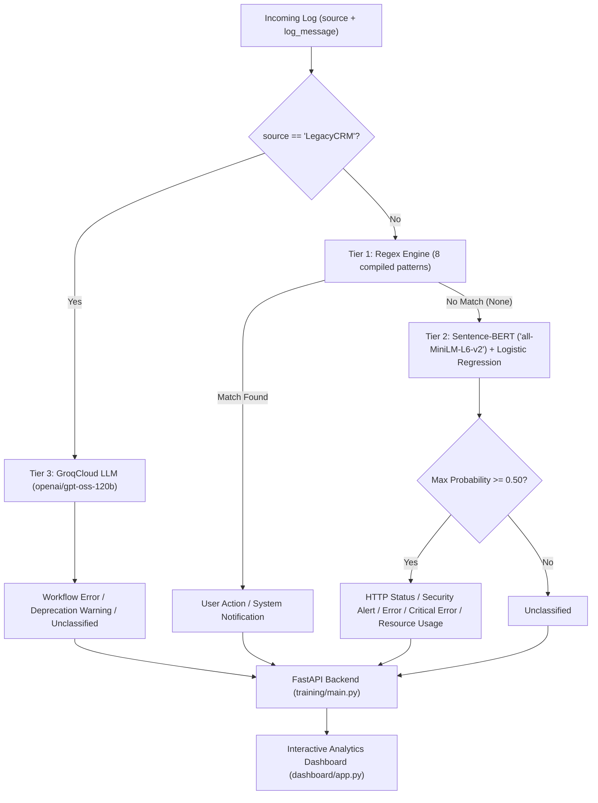
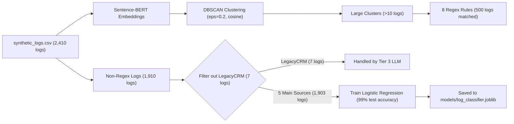

# Hybrid AI-Powered Log Classification & Analytics System

An end-to-end log intelligence application that classifies enterprise software, server, and IT system logs into actionable categories by combining **Regex Rules**, **Sentence-BERT Embeddings + Logistic Regression**, and **Generative AI (GroqCloud LLM)**—served through a **FastAPI** backend and an interactive **Streamlit + Plotly** analytics dashboard.

---

## Why a Hybrid Architecture?

Traditional monitoring relies on coarse levels (`INFO`, `WARNING`, `ERROR`) that hide the real operational meaning or security risk of an event. Instead of routing every single log to an expensive LLM, this system selects the fastest, lowest-cost method that can classify each message accurately:

| Tier | Engine | When Used | Categories Handled | Cost & Speed |
| :--- | :--- | :--- | :--- | :--- |
| **Tier 1** | **Regex** (`processor_regex.py`) | Predictable, repetitive log templates discovered via DBSCAN | `User Action`, `System Notification` | \$0, microseconds |
| **Tier 2** | **Sentence-BERT + Logistic Regression** (`processor_BERT.py`) | Unstructured / varied logs with ample training data (confidence $\ge 0.50$) | `HTTP Status`, `Security Alert`, `Error`, `Critical Error`, `Resource Usage` *(or `Unclassified`)* | \$0 (local), milliseconds |
| **Tier 3** | **Groq LLM** (`processor_LLM.py`) | Rare sources with very few labeled examples (`LegacyCRM`) | `Workflow Error`, `Deprecation Warning`, `Unclassified` | Free-tier / token-based API |

---

## System Architecture



---

## Training & Pattern Discovery Pipeline (`training/training.ipynb`)

During experimentation, **BERT embeddings + DBSCAN clustering** are used to automatically discover recurring log templates so they can be converted into fast Regex rules before training the supervised classifier:



---

## Project Structure

```text
gen ai log classification project/
│
├── dashboard/
│   └── app.py                      # Interactive Streamlit + Plotly analytics dashboard
│
├── models/
│   └── log_classifier.joblib       # Trained Logistic Regression model artifact
│
├── training/
│   ├── dataset/
│   │   └── synthetic_logs.csv      # Labeled training dataset (2,410 rows)
│   ├── resources/
│   │   ├── test.csv                # Sample unlabeled input CSV for testing
│   │   └── output.csv              # Classified CSV generated by pipeline / FastAPI
│   ├── .env                        # Private environment file holding GROQ_API_KEY
│   ├── classify.py                 # Hybrid 3-tier orchestrator & batch CSV classifier
│   ├── main.py                     # FastAPI backend server
│   ├── processor_regex.py          # Tier 1: Compiled Regex rules
│   ├── processor_BERT.py           # Tier 2: Sentence-BERT + Logistic Regression
│   ├── processor_LLM.py            # Tier 3: GroqCloud LLM classifier
│   ├── requirement.txt             # Dependencies list
│   └── training.ipynb              # EDA, DBSCAN clustering & model training notebook
│
├── .gitignore                      # Keeps .env, caches, and generated outputs out of Git
├── requirements.txt                # Project-wide Python dependencies
└── README.md
```

---

## Setup & Installation (Windows PowerShell)

1. **Install Dependencies**
   ```powershell
   pip install -r requirements.txt
   ```
   *(If you want the lightweight CPU-only PyTorch build, run `pip install torch --index-url https://download.pytorch.org/whl/cpu` before installing `requirements.txt`.)*

2. **Configure Your GroqCloud API Key**
   Create or edit `training/.env` and add your **free GroqCloud API key** from [console.groq.com/keys](https://console.groq.com/keys):
   ```env
   GROQ_API_KEY=gsk_your_actual_groq_api_key_here
   ```
   > **Note:** `openai/gpt-oss-120b` is an **open-weight model hosted on GroqCloud** and accessed through your `GROQ_API_KEY`—it does **not** use or charge a paid OpenAI API key.

---

## How to Run & Test

### 1. Run the FastAPI Server & Web Dashboard
Start the server from the project root:
```powershell
python -m uvicorn training.main:app --reload
```
Keep that terminal running, then **open your web browser** and go to:
* **LogGuard AI Dashboard (Desktop & Mobile):** **`http://127.0.0.1:8000/`**
* **Swagger UI (Interactive API Docs):** **`http://127.0.0.1:8000/docs`**
* **Health Check:** **`http://127.0.0.1:8000/health`**

**Testing CSV Upload in Swagger UI:**
1. Click **`POST /classify/`** $\rightarrow$ **Try it out**.
2. Choose **`training/resources/test.csv`** and click **Execute**.
3. Download the returned `output.csv` (or inspect `training/resources/output.csv`).

**Or test single-log classification in a second PowerShell window:**
```powershell
Invoke-RestMethod -Uri "http://127.0.0.1:8000/classify-log/" -Method Post -ContentType "application/json" -Body '{"source": "LegacyCRM", "log_message": "Case escalation for ticket ID 7324 failed because the assigned support agent is no longer active."}'
```

---

### 2. Optional: Launch the Streamlit Dashboard
If you also want the Streamlit version, install Streamlit & Plotly and run:
```powershell
python -m streamlit run dashboard/app.py
```
Then open **`http://localhost:8501`** in your web browser to view:
* KPI metrics (total logs, security alerts, system/critical errors, and % handled locally without LLM calls)
* Category distribution, Regex/BERT/LLM routing share, per-source breakdown, and event timeline charts
* High-severity alerts table, live single-log tester, and CSV upload/download

---

### 3. Test Individual Pipeline Modules
```powershell
python training/processor_regex.py
python training/processor_BERT.py
python training/processor_LLM.py
python training/classify.py
```
